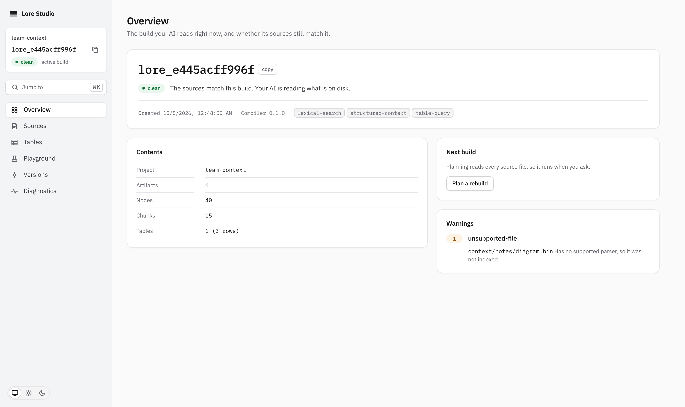
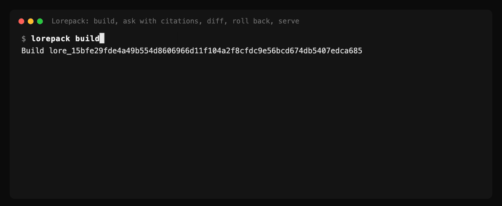

# Lorepack

Lorepack turns the documents and tables your AI depends on into versioned context builds.
It gives an agent a stable, inspectable source of truth instead of an untracked folder or a
mutable search index.

Every build is immutable and content-addressed. You can inspect what entered it, see what was
excluded and why, ask for bounded context with citations, compare versions, activate a known
version, and roll back without rebuilding. AI clients read the active build over MCP or HTTP.
They cannot edit sources, build, deploy, or run shell commands through the Lorepack boundary.

Local project state keeps a persistent corpus ID and runtime namespace separately from the
content digest and display name. These identify the collection; local owner access remains
the trust boundary. See [local storage](docs/architecture/local-storage.md).
Build, search, context, source-read and table-result envelopes expose these identifiers
consistently over CLI JSON, HTTP, MCP and the SDK. A deployment retains the corpus ID and
gets its own persistent namespace; the IDs never replace authentication.

## Why teams use it

Lorepack is for teams whose AI answers must be grounded in project material that changes over
time:

- Keep engineering runbooks, product specifications, policies, and operational notes in a
  reviewable context build.
- Let Claude Code, Codex, VS Code, or another MCP client answer from the same local build.
- Preserve spreadsheets as typed tables instead of flattening them into prose.
- Review a context update before activating it, then recover immediately if a bad source update
  reaches the active version.
- Inspect every answer back to a file, heading, line range, sheet, or cell range.

Lorepack is a context build system, not a hosted knowledge base, generic crawler, chat app, or
replacement for your source control. Retrieval is one capability of a versioned build.

## Where Lorepack fits

Lorepack is useful when an AI system depends on files that change and those changes need the
same reviewability as code or infrastructure. Common environments include:

- Local coding agents that need one checked-in context for a repository, its runbooks, and its
  design documents.
- Engineering and operations teams that review deployment procedures, incident notes, and
  policies before an agent can use a new version.
- Regulated or security-sensitive teams that need immutable builds, explicit activation, and a
  source location for every returned passage or table row.
- Product and research teams that work from evolving specifications, decision records, and
  experiment notes without copying them into a second knowledge base.
- CI and release workflows that need to build, validate, compare, package, or roll back context
  as part of a repeatable change process.
- Teams serving several AI clients from one local or packaged build through MCP or HTTP while
  keeping lifecycle changes in developer-controlled tooling.

The Terraform analogy describes the lifecycle, not infrastructure provisioning. `lore.yaml` is
the desired context configuration. `lorepack plan` previews the candidate, `lorepack build`
compiles an immutable artifact, `lorepack validate` compiles and checks a candidate without moving the active pointer,
and `lorepack activate` changes that pointer. `lorepack diff` reviews versions and
`lorepack rollback` selects a previous immutable build. This separates desired inputs, review,
and activation. Lorepack does not provision cloud resources and does not mutate source files.

This is a good fit when provenance, reproducibility, and safe updates matter as much as asking a
question. It is not a replacement for OCR, SaaS connectors, or a hosted multi-user knowledge
platform in v0.1.

## Lorepack Studio

`lorepack dev` serves Lorepack Studio locally. It is an inspector for the active build:

- Overview shows the active id, freshness, compiler information, capabilities, warnings, and
  the next rebuild step.
- Sources shows indexed artifacts and excluded files with reasons.
- Playground assembles bounded context and shows selections, omissions, budget accounting, and
  the equivalent CLI, HTTP, and MCP request.
- Tables shows typed schemas, sample rows, and bounded read-only queries when tables exist.
- Versions shows build history, diffs, activation, rollback, and portable packaging.
- Diagnostics shows environment checks, watcher state, and detected AI clients.



Read the [Studio tour](docs/studio-tour.md) for route-by-route screenshots, workflow recordings,
and the actions behind each view.

## Start in two commands

Requires Node.js `>=24.19.0 <25`. The first alpha is published on npm's `next` channel:

```bash
npm install -g @lorepack/cli@next
lorepack dev ./my-docs
```

`lorepack dev` builds the folder, starts the local read-mostly server, opens Lorepack Studio,
and prints the MCP and HTTP endpoints. It also prints the connection command for AI clients it
detects on your machine.

To connect an installed client, run the command Studio prints or use:

```bash
lorepack connect claude-code
```

The command changes only that client's Lorepack configuration. It does not upload your sources.
See the [client integration guides](docs/integrations/) for Claude Code, Codex, VS Code, and
generic MCP clients.
The stdio server closes on stdin EOF or POSIX termination signals; see [shutdown behavior](docs/integrations/mcp.md#shutdown).

### Shell completion

Generate completion for the shell you use:

```bash
eval "$(lorepack completion zsh)"       # zsh
eval "$(lorepack completion bash)"      # bash
lorepack completion fish | source       # fish
lorepack completion powershell | Invoke-Expression
```

Add the matching line to your shell profile when you want completion in every new terminal.
The generated completion covers Lorepack commands and global options without requiring a plugin.



[View the static, reduced-motion version of the demo](docs/images/demo.svg).

## A complete local workflow

### 1. Create a project

For a new context directory, initialize the small set of files Lorepack needs:

```bash
mkdir my-context
cd my-context
lorepack init .
```

This creates `lore.yaml`, `.loreignore`, and the project entries in `.gitignore`. Commit
`lore.yaml`, `lore.lock`, and `.loreignore`. The `.lore/` directory contains local build state
and is intentionally ignored.

Point `lore.yaml` at the directories or files that are part of the context. Keep source files
in their original structure. The [format and parser guide](docs/architecture/parsers.md) lists
the supported formats and their structural behavior.

### 2. Preview and build

Preview what will be read before compiling it:

```bash
lorepack plan
```

Then create and activate an immutable build:

```bash
lorepack build
lorepack status
```

The build output includes a content-addressed id, artifact and chunk counts, tables, warnings,
and activation status. A failed build leaves the active version untouched.

Use `--json` in scripts and CI. Use `--frozen` when the checked-in lockfile must not change:

```bash
lorepack build --frozen --json
```

### 3. Inspect what the AI can read

Search returns source coordinates with every result:

```bash
lorepack search "how long do we keep support transcripts"
```

Inspect the build and its decisions directly:

```bash
lorepack inspect build
lorepack inspect sources
lorepack inspect exclusions
lorepack inspect warnings
```

Assemble bounded context for a task without calling a model:

```bash
lorepack export --task "How should the sync worker recover after a failed deploy?"
```

The export contains the selected passages and their provenance. The budget covers
complete CLI JSON, HTTP, MCP and Markdown output using a versioned UTF-8 estimate, with
a separate 4 MiB byte ceiling. It is not a provider token count. Omission totals remain
complete when diagnostic detail is shortened to fit. See [delivery limits](docs/architecture/retrieval.md#delivered-context-limits).

JSON includes resolved
execution policy and selection IDs; Markdown prints both IDs. These identify the runtime
configuration and build-scoped request separately from the immutable content build. Lorepack does not summarize
source material or decide which user-declared authority is correct.

Selected context preserves complete native evidence units, including conditions inside
the same paragraph or table. Units that cannot resolve or fit are explicitly omitted.
This does not infer qualifications across separate documents. See
[the boundaries and limits](docs/adr/0015-native-context-evidence.md).

HTTP and MCP task requests can opt into a detached receipt identifying the exact
emitted content bytes and build. Receipt creation does not enable query logging
or prove model use. See [receipt boundaries and retention](docs/architecture/context_receipts.md).
CLI exports write the same detached contract with `--receipt <file>`; add
`--capture-request` only when the receipt should retain the normalized task.
The SDK returns verified receipt and original bytes with `contextForTaskWithReceipt`;
Studio offers opt-in receipts and separate downloads for the exact context and receipt.
Receipts work on local and Cloudflare runtimes, including explicitly allowed browser origins.
Receipted context uses the same complete native units and whole-unit budget omissions.

### 4. Serve and connect

Use `dev` while editing sources. It rebuilds after changes and keeps Studio, HTTP, and MCP
aligned with the active build:

```bash
lorepack dev ./my-docs
```

For a previously built project that must only serve the active build, use the read-only server:

```bash
lorepack serve
lorepack mcp
```

To keep a task on one retained version while another build activates, pass the full build ID:
`lorepack serve --build lore_<64-hex-digest>` or `lorepack mcp --build lore_<64-hex-digest>`.
Search and export accept the same `--build` selection. A missing selected build fails; it never
falls back to the active version.

`lorepack serve` never rebuilds or edits sources. `lorepack mcp` is useful as the command in an
MCP client's stdio configuration. `lorepack connect <client>` shows the change it would make
to the client configuration and asks before writing it. `--dry-run` only shows it, and `--yes`
applies it without asking, which a script or CI job has to pass because there is no terminal
to ask on.

### 5. Update safely

Edit a source, then see the candidate changes before activation:

```bash
lorepack plan
lorepack build
lorepack diff
lorepack builds
```

The active pointer changes only after validation succeeds. To return to the previous build:

```bash
lorepack rollback
lorepack status
```

Local `prune` preserves acquired reads and open runtime references, including normalized
objects shared with retained builds. Its plan identifies those references. A running server
may postpone deletion until it releases the catalog or closes. An explicit `serve --build` or
`mcp --build` owns that selection for its whole server lifetime, including between requests.
Reads fail safely if ownership cannot be recorded.

Cloudflare reads also own their captured build and normalized objects during cleanup. Each
remote operation must finish within five minutes; an expired operation returns an explicit
limit error, even when its data was already loaded. Cleanup and activation share a primary
database fence, so a build claimed for deletion cannot become active. An unconfirmed remote
write blocks later mutations until its completion is established; it is never blindly retried. See
[remote cleanup](docs/architecture/deployment.md#cloudflare-remote-cleanup) for the lifetime
and concurrent-operation behavior.
Cleanup progress retains each confirmed R2 deletion if a later deletion fails, so a
resumed operation reports the complete set of completed removals.

Rollback points at an existing immutable build. It does not recompile the sources, and it
works after the source directory and parser cache are removed. Keep `lore.yaml` and `.lore/`:
they identify the project and hold its retained builds and content objects. A missing or
invalid target fails before the active pointer changes.

Use `lorepack validate --build <full-build-id>` to verify a retained build from its sealed
catalog, manifest, identity inputs and normalized objects, even after sources change or
disappear. It does not compile sources or move the active pointer. Candidate checks
also verify stored mappings and source bounds before sealing. See the
[validation contract](docs/validation.md) for checks, limits and unsupported builds.

Retained builds remain available to inspection, diff, search, export and read-only serving.
When sources are unavailable, query freshness is `unknown`. Use `lorepack mcp --active-only`
to serve retained content without checking or rebuilding sources. `plan`, `build`, `dev`,
`status` and `mcp --ensure-current` still require live sources.

### 6. Package or deploy a build

Create a portable archive and verify it before sharing it:

```bash
lorepack pack --out context.lorepack
lorepack pack --verify context.lorepack
```

On a machine without the source project, import the archive into an empty directory:

```bash
lorepack --cwd ./consumer import ../context.lorepack
lorepack --cwd ./consumer activate <build-id>
lorepack --cwd ./consumer mcp --active-only
```

The archive path is relative to `--cwd`. Import verifies the complete build, retains its
exact ID and normalized content, and creates a minimal consumer configuration if needed.
It never compiles or activates. Existing projects keep their active version and runtime
identity. Original source files are not restored. See the
[import contract](docs/package-format/README.md#importing-a-build) for limits and failures.

Cloudflare deployment is an optional target. It projects the same build rather than compiling a
different representation remotely. Read the [deployment guide](docs/architecture/deployment.md)
before configuring a target.

## Workflows worth copying

Search and task context use current-only evidence by default. If only archived or user-declared
superseded material matches, the selection is empty; Lorepack never fills it with historical
bodies automatically. Drafts remain eligible and labeled. Request history explicitly with
`lorepack search --include-archived`, `lorepack export --include-archived`, or
`includeArchived: true` through the SDK, HTTP or MCP. Historical items retain their labels
and locators. This policy does not decide which document is true.

### Keep a coding agent on a reviewed context version

```bash
lorepack plan
lorepack build --no-activate
lorepack validate
lorepack diff
lorepack activate
lorepack mcp --follow-active
```

The agent sees only the active immutable build. If the source change is wrong, `lorepack rollback`
returns to the previous build without parsing or indexing the sources again. `--follow-active`
reports dirty or unknown freshness without rebuilding. Bare `mcp` and `--ensure-current`
reconcile live sources at startup; use them for development rather than reviewed activation.
`--active-only` follows activation without source checks. `--build <full-id>` pins one retained
build instead of following later activation or rollback.

### Investigate a source before changing the build

```bash
lorepack inspect sources
lorepack inspect exclusions
lorepack inspect warnings
lorepack search "where is the deployment rollback procedure"
lorepack export --task "prepare a cited rollback checklist"
```

This is useful when a result is missing. It shows whether the file was parsed, excluded by a
project rule, refused because no parser supports it, or simply did not match the query.

### Review context in Studio

```bash
lorepack dev ./my-docs
```

Open Sources to inspect artifacts and exclusions, Playground to assemble a bounded task bundle,
and Versions to compare, activate, pack, or roll back builds. The same workflows are shown in
the [Studio tour](docs/studio-tour.md). The recordings are optional motion summaries; the tour
also keeps static screenshots for reduced-motion and offline readers. Regenerate recordings with
`pnpm docs:studio:gifs`.

### Measure a corpus before making a performance claim

```bash
pnpm bench:corpus -- --scale small --edge-case standard \
  --out benchmarks/corpus/local-small.json
pnpm check:benchmark-artifacts
```

Use `small`, `medium`, or `large` to select scale, and `standard`, `incremental`, `unsupported`,
or `tables` to select an operational edge case. The report includes corpus identity, machine
metadata, build and incremental p50/p95, warm search, context assembly, typed-table latency, and
reuse counts. Read [benchmark methodology](benchmarks/README.md) before comparing results. The
medium and large tiers are deterministic copies of repository-owned mixed-format material, so
they show scale trends rather than proving performance on every customer corpus.

## What makes the build trustworthy

### Immutable identity

The build id comes from canonical inputs, every registered parser's version (including unused
parsers), compiler version, configuration, and structure. The
[package-format contract and frozen vectors](docs/package-format/README.md#build-id-derivation)
define the exact inputs. It does not depend on timestamps, hostnames, absolute paths, or
physical SQLite bytes. The same canonical inputs produce the same id across supported operating systems.
Newly compiled builds retain the exact identity inputs in `reports/build-id-inputs.json`.
These support independent verification without returning to live sources. Canonical hashing
uses the same byte serialization in local Node and the portable Worker-safe core.

Archive verification requires a compatible manifest, catalog and complete identity inputs.
It recomputes catalog roots and the build ID, checks required content-addressed objects,
and refuses link or device entries. Success reports integrity only and an unsigned publisher.
Older archives missing identity inputs are explicitly unsupported for verification.
See the [package format](docs/package-format/README.md#archive-structure).

### Provenance on every result

Search results, exported context items, and table-query results carry a `SourceLocator`. A locator can
name a path, heading, line range, sheet, or cell range. This makes an answer auditable without
requiring Lorepack to claim that one document is more truthful than another.

### Structure before retrieval

Markdown headings, code boundaries, directories, spreadsheet sheets, columns, and cell ranges
remain meaningful inside the build. CSV and XLSX data is stored as typed tables and exposed
through a bounded read-only SQL surface.

Table query results identify the captured build, table and query. Their locator is
explicitly table-level, including filtered or aggregate results; exact source-row and
cell attribution is unsupported. See the [query contract](docs/adr/0014-table-query-identity.md).

### Read-only AI boundary

Model-facing MCP and HTTP capabilities read an immutable active build. They cannot build,
activate, roll back, deploy, modify source files, or execute shell commands. Mutating lifecycle
actions remain explicit CLI or Studio operations performed by the developer.

## Supported inputs and current boundaries

The alpha supports the document, text, PDF, CSV, and XLSX paths described in the parser guide.
It preserves the structure those parsers expose and records unsupported or excluded files as
warnings. The default install has no Python, Docker, native add-on, model download, API key,
account, or hosted service requirement.

The first public alpha deliberately does not include OCR, images or screenshots, PPTX, SaaS
connectors, multi-user tenancy, automatic conflict detection, generated summaries, embeddings
in the default install, knowledge graphs, conversation memory, agent workflows, or server-side
compilation on Cloudflare. See the complete [limitations](docs/limitations.md) page before
designing a production integration.

## Documentation map

- [Getting started](docs/getting-started.md): requirements, installation, the first build, and
  the lifecycle.
- [Core concepts](docs/concepts.md): why the immutable build is the product and how Lorepack
  differs from RAG servers, MCP wrappers, and vector databases.
- [CLI reference](docs/cli-reference.md): every command, argument, and option.
- [Studio tour](docs/studio-tour.md): the local inspector and its routes.
- [Demo transcript](docs/demo-transcript.md): real output from the complete lifecycle.
- [Client integrations](docs/integrations/): Claude Code, Codex, VS Code, and generic MCP.
- [Architecture](docs/architecture/README.md): package boundaries, build identity, storage,
  serving, security, and deployment.
- [Package format](docs/package-format/README.md): the `.lorepack` archive and generated
  schemas.
- [Compatibility](docs/compatibility/README.md): supported platforms and measured behavior.
- [Benchmark evidence](docs/compatibility/benchmark-evidence.md): reproducible Lorepack, FTS5,
  and offline RAG comparisons, claim ledger, raw artifacts, and review checklist.

## Source installation

Contributors and users testing unreleased changes can build from source:

```bash
git clone https://github.com/burakdede/lorepack.git
cd lorepack
corepack enable
pnpm install --frozen-lockfile
pnpm build
alias lorepack="node $PWD/packages/cli/dist/public-entry.js"
```

Run `lorepack doctor --json` when diagnosing an environment. Include that output, your OS, and
your Node.js version in a bug report.

## Contributing

CI retains complete Git history for the changeset gate, including long pull request branches.

CLI deployment tooling uses the [deployment client boundary](docs/architecture/packages.md)
so control operations do not initialize Worker protocol adapters.
Keep protocol SDK loading inside the handlers that use it.
Published CLI builds preserve that boundary with shared ESM chunks.

Read [CONTRIBUTING.md](CONTRIBUTING.md) and [AGENTS.md](AGENTS.md) before changing the project.
The project uses Apache-2.0 licensing. Security reports belong in [SECURITY.md](SECURITY.md).
Contributor tests use Vitest 4.1.11, including the redirect-mock file-serving security fix.
Its integration fixtures keep startup diagnostics separate from machine-readable results.
The test toolchain is outside the published runtime dependencies; see the
[CI guide](docs/architecture/ci.md) for its regression checks.
Studio development uses Vite 7.3.7. Users receive Studio's built assets in the CLI;
see the [dependency decisions](docs/architecture/dependencies.md) for contributor tooling.
Release preparation uses Changesets 3.0.3 with the existing private-package version policy.
Contributor Cloudflare checks use Wrangler 4.149.0; see the dependency decisions above.
Their bounded propagation retries require successful upload evidence for the newer API.
Contract tests use the same MCP client version as the shipped CLI.
`pnpm check:supply-chain` checks production dependencies and rejects High or Critical
findings in contributor dependencies.

## License

[Apache-2.0](LICENSE)
