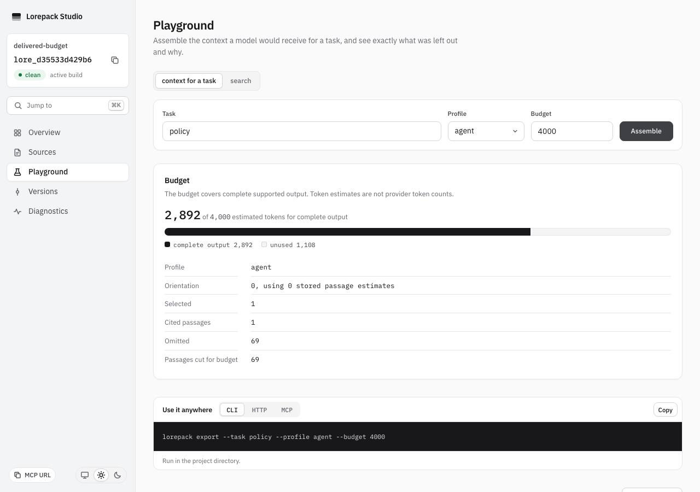
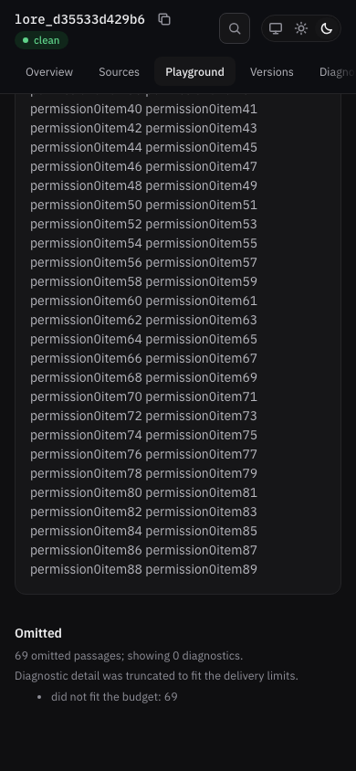

# Complete context delivery verification

Verified 2026-10-12 on macOS arm64, Node24.21.0 and the repository's Playwright
Chromium1.62.1. No provider tokenizer or physical screen reader was used.

The actual built CLI compiled 70 Markdown policies, each with 90 unique words.
Studio requested task `policy`, profile `agent`, budget4,000. The result contained
one whole passage and estimated2,892 tokens across complete supported output.
All69 omissions remained in reason totals; no diagnostic entries fit the chosen
packing sequence, and truncation was explicit. These figures describe this fixture,
not a performance claim or a provider token count.

Automated evidence:

- `packages/cli/test/delivered_context_budget.test.ts` drives actual CLI JSON,
  Markdown, HTTP and complete MCP replies with the same corpus and request.
- `packages/runtime/test/delivered_budget.test.ts` verifies exact fit, one-unit
  overflow, Unicode/escaping, 1,000 omissions, five alternatives and the hard ceiling.
- `scripts/check-packed-cli.mjs` verifies actual npm-installed JSON/Markdown
  delivery, exact accounting and nonempty evidence.
- `apps/studio/test/playground.test.tsx` verifies full omission totals, reported
  diagnostic counts and an explicit truncated state even when no entries fit.

Manual browser checklist, executed against real `lorepack dev`:

- At1280x900 in light theme, the tape labels complete output rather than treating
  framing as selected text. Stored passage estimates remain separate facts.
- At390x844 in dark theme, labels and totals wrap without page overflow.
- The selected passage and citation remain visible. All69 budget omissions appear
  in totals, and zero diagnostic entries are described explicitly without an empty table.
- Both requests return HTTP200. No browser errors or page-level overflow occur.
- The final desktop and mobile captures were opened and visually inspected.

The real Studio end-to-end accounting scenario checks the complete-output note and
compares displayed used, budget and unused values with the actual browser context
response. This catches drift between the shared runtime contract and the UI without
mocked estimates. The old exact-copy assertion was updated with the new contract.
