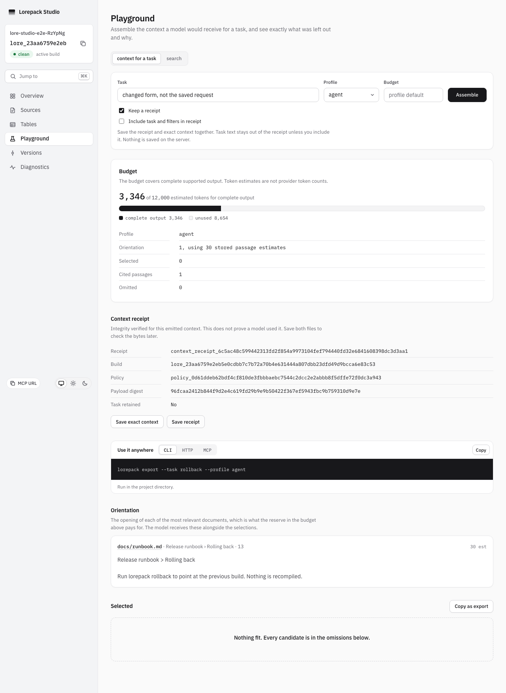
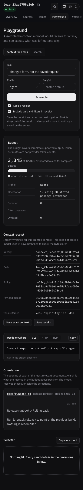

# Detached receipt verification

Verified on 2026-10-12 with Node24.21.0, macOS arm64, Playwright1.62.1 and
Chromium151.0.7922.34. Studio uses the actual bundled CLI server and HTTP SDK.

- Assemble with receipts off: no receipt section or server retention.
- Select Keep a receipt. Task capture remains off until explicitly selected.
- Assemble, edit the task form, then save exact context and receipt. Downloads
  retain the assembled response; they do not rerun the edited request.
- Compare downloaded bytes with the actual HTTP response. Independently check
  SHA256, byte count, full build ID and explicit request-retention flag.
- Check desktop1280 light and mobile390 dark. Long identities wrap, actions remain
  available, no horizontal overflow and no serious/critical axe violations.
- SDK corruption regressions cover changed payload/newline, altered digests,
  unsupported version, absent header and unknown receipt fields. All refuse
  with LORE_E_SCHEMA_MISMATCH without retrying the context POST.

Commands executed:

```sh
pnpm exec vitest run apps/studio/test/playground.test.tsx apps/studio/test/equivalents.test.tsx
pnpm --filter @lorepack/studio-e2e exec playwright test receipts.spec.ts
```

Component/equivalent tests:29 passed. Actual browser downloads:2 passed.
Screenshots were inspected. Full release qualification remains separate #102.




## Worker and installed-package evidence

Projected Worker HTTP/MCP receipts verify retained build A after B activation and removal
of the producing build directory. Explicit request capture and corruption refusal pass.
An allowed browser origin can read the detached header; no allowlist is widened.
Actual Wrangler4.119.0 Workerd/D1/R2 emulation passed all3 tests, including both receipt
transports. Initial context assertions exposed missing search tables in the older fixture;
its seed now uses the actual projection migration statements and a real indexed chunk.

`pnpm check:packed-cli` installed145 packages with npm, matched the tested production tree,
validated and imported the immutable archive, removed its producer, then verified exact
JSON/Markdown stdout receipt digests and byte counts. Archive/table-child/PDF checks passed;
`npm audit --omit=dev` reported0 vulnerabilities. The script's8 focused tests also pass.
Hosted receipt assertions are part of the existing credentialed deployment acceptance
flow; local emulation does not count as real hosted verification.

## Combined native-evidence contract

After integrating merged #698,38 focused CLI receipt/native-closure/Core/SDK parity tests
pass. Real source-free HTTP/MCP reads at4,000 and8,000 include the exact complete paragraph
and trailing owner-approval condition whenever delivered, allowing its canonical heading.
At8,000 the native body must be delivered; a whole-unit budget omission is explicit when
it cannot fit. MCP estimates include receipt metadata. The initial test incorrectly
excluded the native heading; its expected forms now preserve both hierarchy and the
entire paragraph. A misnamed test filter was corrected to the discovered file path.

The standalone receipt schema check failed after rebase because the newly introduced
schema still described only chunk packing. Regenerated it from current Core definitions;
the schema check passes with native-unit packing and its declared materialization cap.

The combined installed-package campaign passed145-package parity, native qualification in
receipted source-free JSON/Markdown, archive validation, table-child/PDF checks and audit0.
The native merge added SDK type fields that exceeded the existing source-size gate by100
characters. Shortened duplicated source prose; the20,000-character gate remains unchanged.
