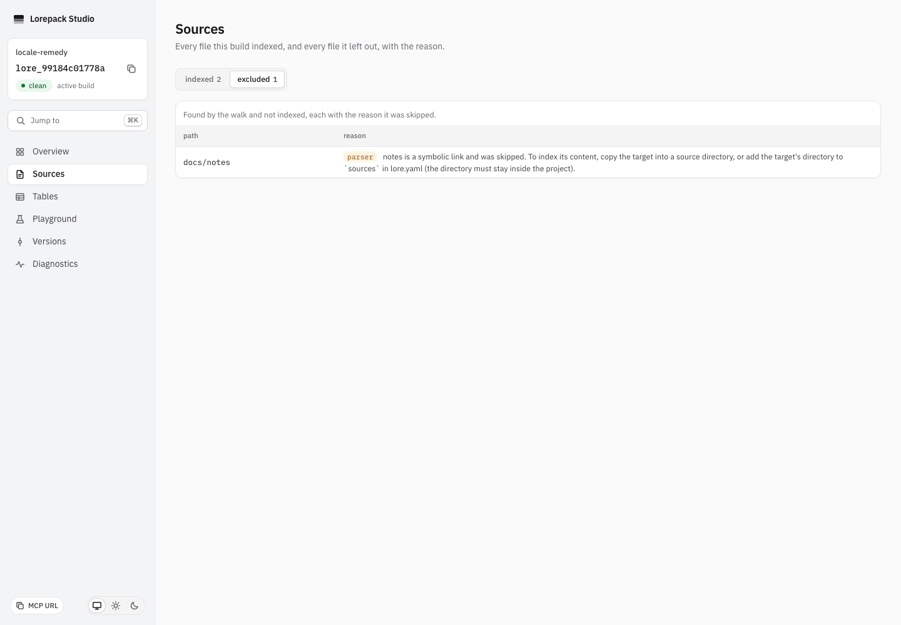

# Deterministic diff and source advice

Tracked in #592. Keep raw content identity unchanged; this correction changes
ordering and advice, not source bytes or the schema.

1. Build `rates.csv` containing `ä,z,a\n1,1,1\n`, change its row to `2,2,2`,
   then build again. Run the actual CLI diff under `LANG`/`LC_ALL` values
   `sv_SE.UTF-8` and `en_US.UTF-8`. JSON bytes must agree, and changed columns must
   be `a,z,ä`, even on a host that retains its system locale.
2. Use `lorepack dev` to read the same diff through
   `/v1/builds/{from}/diff/{to}`, Studio Versions and the real MCP resource
   `lore://build/{from}/diff/{to}`. Compare exact results with CLI JSON. The HTTP
   build-history routes belong to dev; read-only serve intentionally omits them.
3. Put a directory link inside `docs` pointing to another directory inside the
   project. Plan/build must name the skipped link and recommend a usable remedy.
   Add that target directory to strict `lore.yaml` sources, build and search its
   content. Never add the unavailable `followSymlinks` key.
4. Compare two otherwise identical projects containing LF and CRLF copies of
   `docs/guide.md`. Build IDs and the raw artifacts root differ; normalized nodes,
   chunks, tables and objects match. The exact measured fixture is in
   [build identity](../architecture/build-identity.md#line-endings-are-part-of-identity).

The regression suite covers compiler discovery, direct and actual CLI diff,
working CLI source configuration, and a real scoped Biome plugin probe. The
plugin probes one-, two- and three-argument calls in core/compiler, with CLI as
an out-of-scope control. No existing workload, deadline or assertion is reduced.

## Recorded manual check

On 2026-10-16, macOS arm64 / Node 24.21.0, actual CLI, dev HTTP and a real MCP
client returned equal diffs with `a,z,ä` cell order. Studio Versions consumed the
same canonical order. Chromium 151.0.7922.34 / Playwright 1.62.1 showed the new
symlink advice without page errors or serious/critical axe 4.11 findings.
The first manual attempt used serve for a dev-only HTTP route and correctly
received404; it was corrected to use the documented dev deployment mode.

