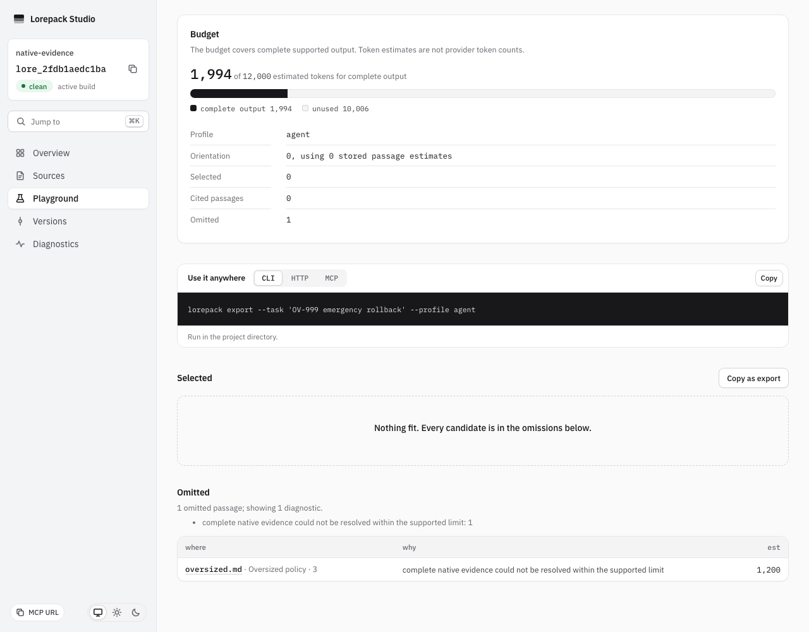
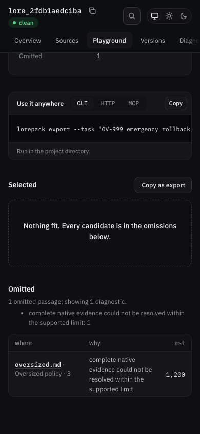

# Native evidence closure

Issue #698. Local checks on macOS arm64, Node 24.21.0, 2026-10-12.
Native CI qualification remains pending.

Packaged CLI JSON/Markdown, actual HTTP and the full MCP result preserve the permission
and qualification after source deletion at budget 8,000. Their complete output fits
that budget. A larger native paragraph is omitted whole at 4,000 and admitted complete
at 40,000; omission totals identify budget rather than structural failure.

The real compiled fixture uses one native paragraph containing a ZX-88 emergency
rollback permission, 120 repetitions of operational prose, and a trailing only-if
approval condition with explicit negation. The original runtime fails at both
4,000 and 8,000 budgets. A large native Markdown table independently fails to retain
its trailing definition with the original runtime.

Run `pnpm exec vitest run packages/cli/test/native_evidence_closure.test.ts` after
building packages. Selected permission must include the complete paragraph and its
qualification, with its actual locator. Reading retained A after activating B and
deleting sources must preserve that evidence. A selected native table must retain
its header, trailing definition and complete line range.

Run the real adapter checks:

```bash
pnpm exec vitest run packages/backend-local/test/catalog.test.ts \
  packages/deploy-cloudflare/test/runtime-contract.test.ts
```

Real SQL checks the exact
65,536-byte boundary, overflow, referenced-node ordering and missing references.
Projected retained A after B activation retains the condition. Oversized projected
units produce an explicit structural omission and no permission fragment.

Limits: closure covers canonical nodes referenced by the candidate and recorded
ancestor labels. It does not infer links between separate paragraphs or documents,
resolve authority as truth, or reconstruct original formatting discarded by parsers.

Studio was inspected using Playwright 1.62.1, Chromium 151.0.7922.34 at 1280 desktop light
and 390 mobile dark widths. The real oversized native fixture shows its structural
omission and locator, complete-output accounting and no selected permission fragment.
Both views have no horizontal overflow or browser errors. The server was stopped after
capture. Screenshots show the implementation integrated with issue424 budgeting.




