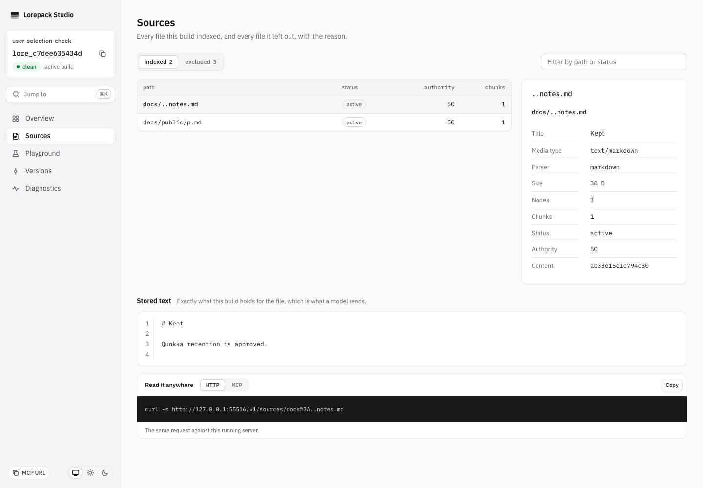
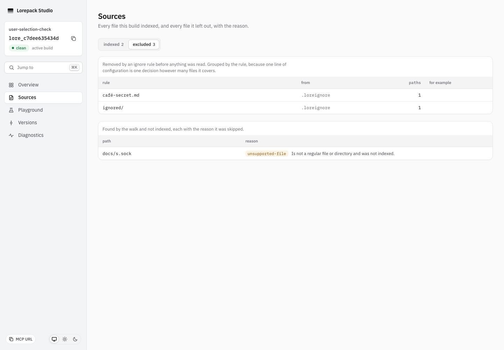

# Path canonicalization verification

Issue #589 covers NFC patterns, valid dot-dot names, normalization collisions and
special-file reporting. [ADR0039](../adr/0039-path-pattern-normalization.md) records
policy version 2 and the requirement to retain immutable version-1 builds.

## Automated checks

On 16 October 2026, macOS arm64 / Node 24.21.0: the original regressions failed nine
cases with three escape controls passing. Additional effective-config and followed
socket regressions failed before correction. The first correction passed 187 tests.
Version-1 archive fixtures then exposed four migration failures, which were retained.
After explicit reader support and correcting a new test to use verified extraction,
349 path/config/compiler/archive cases passed with the Linux-only collision case
skipped. Strict changed-test and product types passed. These scoped results do not
establish full local or native qualification.

The actual bundled CLI/HTTP/MCP case passed on the same platform. It builds equivalent
NFD/NFC pattern configurations in different roots and requires identical build IDs,
finds cited public and `..notes.md` content, verifies declared authority in inventory,
and refuses excluded content through search, inventory and direct reads. The client
is protocol SDK 2.2.0 pinned to MCP 2026-07-28. No desktop trust observation is claimed.

Version-compatibility tests admit complete archives recorded as policy 1 or 2, verify
that the source archive bytes remain unchanged and refuse unknown policy 99 through
both logical verification and verified extraction. Existing archive assertions stay
unchanged. An optional strict check of the old archive file reproduced nine existing
Vitest assertion-generic TS2558 errors on the unchanged baseline; the new dedicated
version test file passes strict types. The legacy optional check is not reported as
passing and the existing assertions were not weakened to address it.

```sh
pnpm build
pnpm exec vitest run packages/compiler/test/path_canonicalization.test.ts packages/core/test/path_boundaries.test.ts packages/core/test/config_pattern_normalization.test.ts packages/backend-local/test/normalization_versions.test.ts packages/cli/test/path_canonicalization.e2e.test.ts
```

Linux and Windows run the real duplicate-name discovery and CLI cases: create both `café.md`
and `cafe\u0301.md` (the latter notation means a combining U+0301 character). Require
a typed collision naming both raw spellings, and unchanged active build after refusal.
Normalization-insensitive APFS cannot stage both names; this is not proved on macOS.
Filesystem socket tests run on POSIX. Windows named pipes are different objects.

## Repeatable user check

In a disposable `sources: [docs]` project, create public `café/current.md`, its older
counterpart, `..notes.md` and `café-secret.md`. Write the decomposed secret filename
into `.loreignore` and decomposed match/supersedes globs into `lore.yaml`. Build and
inspect rules, sources and exclusions. Public and dot-dot documents must remain
cited; the secret must be absent from CLI, HTTP and MCP search and direct reads.
Repeat with composed patterns in another absolute root and compare full build IDs.

On POSIX, add a filesystem socket before building and inspect warnings. Its exact
path must appear as `special-file` / `unsupported-file`. Add a matching ignore rule
and require an exclusion entry instead. In Studio Sources, compare the indexed and
excluded views with these actual rules and warning paths. A live-edit check must
also retain the same connected MCP client across a dot-dot source edit. These manual
and Studio checks supplement the automated boundary tests; full current local/native
qualification remains required.

## Actual live and retained-build check

On 16 October 2026, macOS arm64 / Node 24.21.0, the final scoped correction passed
355 tests in 18 files, with both real duplicate-name cases skipped on this Mac, pending native proof.
Strict types for all six changed test files and product types passed. Additional
special-entry reporting regressions first failed two cases with eight controls;
the watcher socket regression failed one case with two controls before correction.
All failed logs remain retained. No original assertion or deadline was reduced.

The actual `dev` user check kept the same clean build after excluded-only edits,
then activated a new clean build after public and `..notes.md` edits. HTTP and the
same persistent MCP client returned exact line-3 locators and no excluded markers.
The initial user observation exposed a socket watcher error; the corrected run
explicitly required no watcher error and passed. The normal discovery warning
remained visible. The process stayed alive and was stopped before fixture cleanup.

Chromium 151.0.7922.34 / Playwright 1.62.1 displayed the dot-dot document and its
stored text, normalized `café-secret.md` exclusion and exact `docs/s.sock` warning.
The captures below were inspected. There were no page errors or serious/critical
axe 4.11.0 violations in the excluded view. This is desktop browser evidence, not
a native screen-reader, desktop-client trust or Windows descendant-cleanup claim.





The same run used the actual older CLI product 40702e58 to build and pack a nonempty
normalization-policy-1 fixture. The new CLI read its cited content and verified its
archive. The reader kept the recorded build ID, and the archive SHA-256 before and
after was identical. Recorded inputs were inspected to confirm version 1; this is
not a newly built version-2 fixture relabeled as legacy. No recompilation occurred
during the new reader's search or verification. Full current native qualification
and the real Linux duplicate-name refusal remain outstanding.
