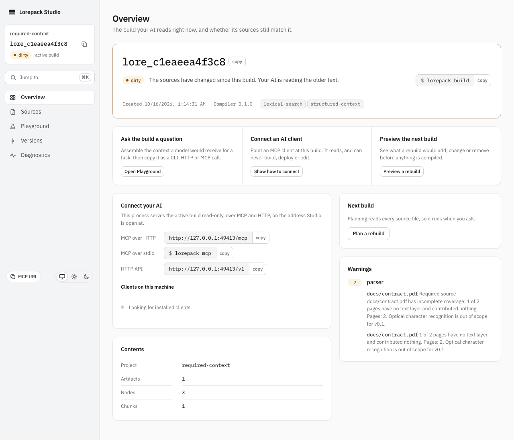
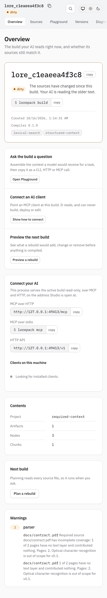

# Required-source coverage verification

Issue [#412](https://github.com/burakdede/lorepack/issues/412) owns the original strict/permissive
PDF and excluded-worksheet requirements. The actual binary test is
`packages/cli/test/required_source_coverage.e2e.test.ts`. It checks cold/cached rejection,
unchanged active build, ignored required input, source-free human/JSON inspection, HTTP
warnings, deterministic roots/declaration order and effective configuration output.

The browser test `tools/studio-e2e/test/required_coverage.spec.ts` builds a real mixed PDF under
a permissive required declaration, removes the source and opens the retained build in Studio.
It checks the coverage message and exact unread page, Axe, and desktop/mobile overflow.

Local verification: 2026-10-16, macOS, Node 24.21.0, Playwright 1.62.1, bundled Chromium. The
attached captures were visually inspected at 1280x720 and 390x844. Both show page 2 and the
required coverage warning after source removal. This is browser/DOM evidence; actual OS
screen-reader and client trust qualification remains under #102.

Manual CLI checklist:

1. Start with a verified active build and a mixed text/image PDF.
2. Declare that exact project-relative file in `build.required`. With `build.profile:
   permissive`, build and inspect warnings: exact unread pages and required coverage appear.
3. Set `build.profile: strict`, rebuild and check exit 2 / `LORE_E_REQUIRED_COVERAGE` plus the
   named path and remediation. Confirm `lorepack builds` still names the prior active build.
4. Repeat with a worksheet the parser cannot import as a table. Declare its exact sheet name.
5. Use `config show --effective` and `config explain build.profile` to check values and layers.
6. Open Studio Overview and Sources; confirm the same immutable warnings remain readable
   after removing original inputs. A dirty-source badge is expected and does not erase a build.

The automated tests cover the CLI paths, HTTP warning delivery and Studio Overview. The
checklist also calls for operator review of Sources. It records what
an operator should verify on their supported client/platform; it does not claim OS-level
assistive-technology or external-client testing.

The existing stale-rollback browser setup assertion records the selected build, expected
active build, HTTP status and actual response body on refusal. The successful path adds no
await, retry or delay, and the assertion remains HTTP200. This is diagnostic context for
[#758](https://github.com/burakdede/lorepack/issues/758), not a claimed correction of its
unproven cause. Preserve failed browser artifacts before another run.

The README demo recorder normalizes the 12 or 13 hexadecimal digits in displayed build
prefixes as well as full build IDs. Canonical policy changes can change those volatile IDs. The demo still compares
actual build IDs before normalization and checks source changes, rollback and archive integrity.
