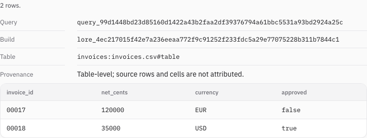
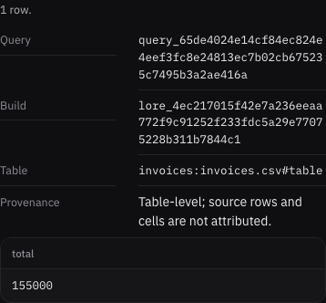

# Table query identity checks

Verified 2026-10-12 on macOS arm64, Node24.21.0, using the built CLI's real Studio
server, Playwright1.62.1 and Chromium151.0.7922.34. Functional regressions live in
`packages/cli/test/query_identity.test.ts`; shared adapter and installed-package
checks cover the same public contract. Native CI qualification is separate.

## Manual checklist

- Compile invoices00017/00018 from a real CSV with padded IDs, integer cents,
  currencies and boolean approval. Open Tables and run the prefilled query.
- Confirm both rows retain their declared values and the result displays its
  complete query ID, captured build ID and table ID.
- Confirm provenance says table-level and explicitly refuses source-row/cell
  attribution. The source locator identifies the table as a whole.
- Run `SUM` over the generated net-cents column. Confirm155000 is a numeric
  aggregate, a different query ID appears and precision remains table-level.
- Inspect1280x900 light and390x844 dark views. Full IDs wrap, no page overflow
  occurs and there are no browser errors. Clipboard and client trust prompts
  were not exercised by this narrow result-display check.

The initial typed query was viewed directly:

The aggregate keeps the same honest precision on mobile:

These screenshots use a two-row CSV, not the release benchmark corpus. They prove
display behavior, not full row/cell lineage or provider correctness. The
[identity decision](../adr/0014-table-query-identity.md) defines replay limits.
