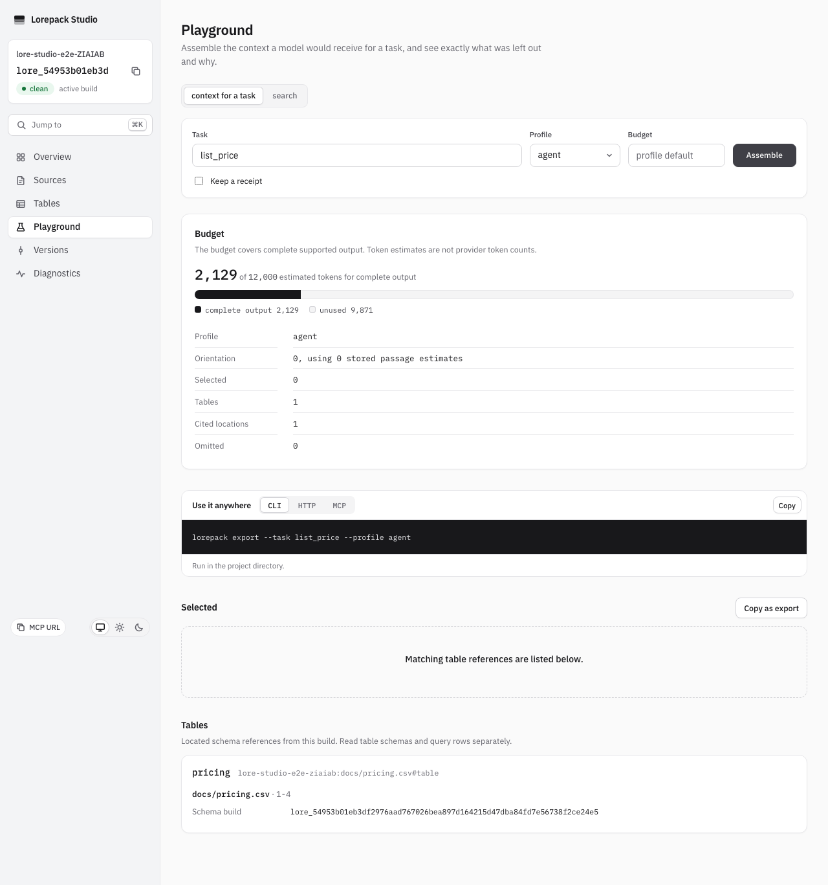
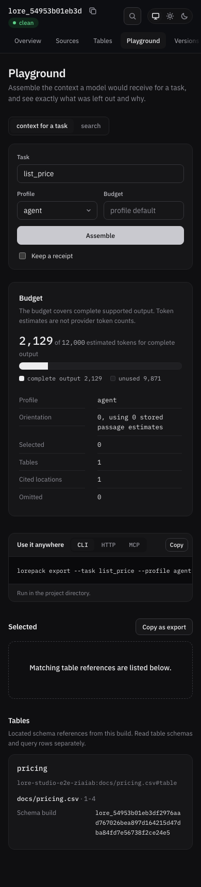

# Table context verification

The regression is tracked in #429. Before the fix, the actual HTTP and MCP contexts and CLI
JSON export returned `tables: []`; Markdown had no Tables section and emitted sample rows.

Automated coverage:

- `packages/cli/test/table_context.test.ts`: actual rate-matrix build through HTTP, actual MCP
  client/server, public CLI JSON and Markdown; no row prose; local and projected D1 filters,
  draft/archive/superseded labels, schema resolution, workbook sheet isolation and old-build
  pinning after another activation.
- `packages/runtime/test/delivered_budget.test.ts`: complete reference accounting, exact fit,
  one estimate below it, oversized metadata, citations and truthful omission totals.
- `packages/deploy-cloudflare/test/query-budget.test.ts`: the original five-query maximum,
  including a cited table task using lexical fallback, without an added metadata round trip.
- `apps/studio/test/playground.test.tsx`: each reference displays its source, build and labels.
- Acceptance scenario `mcp/a-table-task-returns-a-cited-schema-reference`: the actual stdio
  server and both public export formats discover the rate matrix without row prose.

Manual Studio checklist: compile a CSV with columns `region,hourly_rate`, open Playground,
assemble `rate matrix`, and inspect the Tables section. Check the source coordinate and full
schema build ID, and ensure the selected passages contain no sample-row text. Repeat on a
narrow viewport and dark theme; verify long IDs wrap without page-level overflow. Visual
execution and its exact results are recorded in the issue handoff and PR verification.

Verified 2026-10-16 on macOS arm64 with Node24.21.0 and the repository's Playwright1.62.1
Chromium. Both real-browser cases passed at 1280x1000/light and 390x844/dark: the response
contained one table reference and no selected row prose; the reference build matched the
response build; source coordinates and the full schema build ID were visible. Axe reported
no critical or serious violations, and neither viewport had page-level horizontal overflow.
Both final screenshots were opened and visually inspected. The first capture exposed the
old misleading "Nothing fit" copy for table-only results; a failing unit regression and the
browser assertions now verify the corrected reference-specific message. This is not manual
screen-reader qualification.

