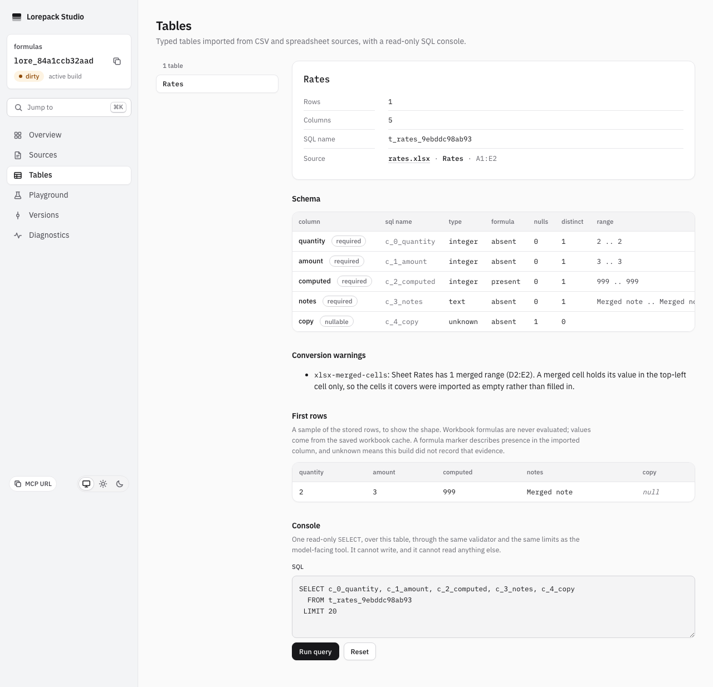
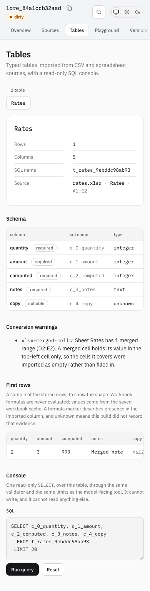

# Verify formula and conversion evidence

Use Node >=24.19 <25. Build the current source before driving CLI or browser tests.
Automated cases live in `packages/cli/test/table_formula_evidence.test.ts` and
`tools/studio-e2e/test/table_formula_evidence.spec.ts`.

1. Build an XLSX with columns `quantity`, `amount`, `computed`, `notes`, `copy`.
   Set quantity to 2, amount to 3 and formula `A2+B2` to cached result 999; merge `D2:E2`.
2. Get the table ID with `lorepack inspect tables`, then run
   `lorepack inspect tables <id> --json`. Computed must say `formula: present`, amount
   `absent`, and the sample must retain 999. Expect the actual `xlsx-merged-cells` warning.
3. Read the same selected build through HTTP, MCP `lore_describe_table` and
   SDK `describeTable(id)`. Compare markers, warnings, sample, locator and full build ID.
4. Project that sealed build to the Cloudflare adapter and repeat the same reads.
   Description must not add a metadata round trip to the existing query budget.
5. Open Studio Tables at desktop and mobile widths. Check markers, cached 999 and the
   top-left conversion warning. Focus the named schema scroll region and verify Arrow-key
   horizontal scrolling at both widths. Verify the sample scroll region on mobile too.
   The page must not scroll horizontally, and diagnostics must remain readable.
6. A historical fixture without `tableEvidence` must show unknown markers and unrecorded
   warnings. CSV `=1+1` stays literal with absent formula markers.
7. Keep the existing 1,000-expression cap; a later formula in another imported column must
   still be present. Shared followers with no expression text also count. An unavailable
   cached value stays null, and a formula-only row stays in the imported table.

## Recorded automated checks

2026-10-16, macOS arm64, Node 24.21.0, Chromium 151.0.7922.34:
actual local and projected SQLite integration, HTTP/MCP/SDK/CLI reads, retained cached values,
shared formulas, absent caches and warning isolation passed in the targeted suite. The actual
Studio flow passed at 1280x900 and 390x844, including keyboard scrolling, axe and page overflow
checks. Both captures below were opened and inspected. These automated checks do not replace
the release's separate manual screen-reader and native client trust checks.

