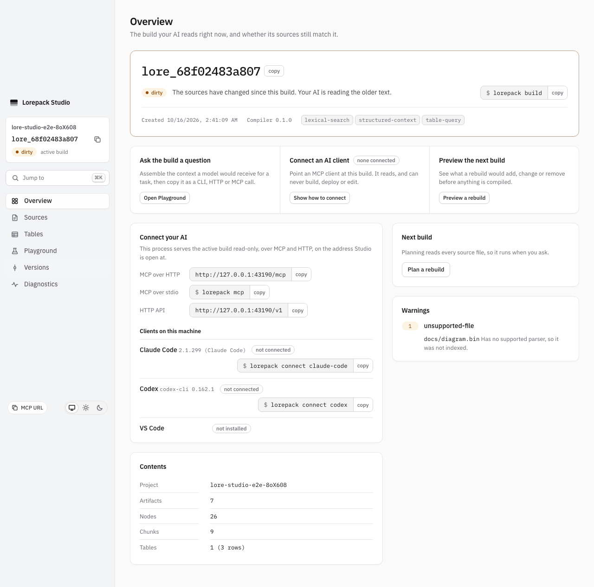

# Watcher activation preservation

Issue #758 covers unchanged source events overriding an explicit activation. The original
Studio setup HTTP400 response was not captured, so its exact cause remains unproven.
The browser setup now reports selected and expected build IDs and the actual refusal body
on failure. Keep the stale-confirmation and competing-activation assertions unchanged.

## Automated evidence

`packages/cli/test/watch.test.ts` uses real builds, SQLite pointers and the Studio activation
endpoint. The identical-rewrite and unsupported-file regressions failed before the fix.
The complete file also covers genuine edits after older activation, same-input retries after
a failed build, and inputs changing between observation and compilation. These cases retain
the existing debounce, stability and test deadlines.

`packages/cli/test/activation_guard_http.test.ts` holds a real project lock, sends an actual
HTTP activation request with the expected active build, then moves the pointer before the
waiting request acquires the lock. It captures selected/expected IDs, HTTP400 and the typed
`LORE_E_INVALID_ARGUMENT` response, and asserts that the competing pointer and generation
survive. This establishes a controlled refusal mechanism; it does not reconstruct the
uncaptured historical browser failure. Run with `--disableConsoleIntercept` to retain the receipt.

The real `lorepack dev` lifecycle test waits for an actual processed no-op before checking
that HTTP and MCP still read the rolled-back build. The Studio browser regression activates
an older build through its confirmation UI, waits for the actual watcher no-op, checks the
header and dirty banner, captures the screen, then verifies a genuine edit resumes building.

Run the complete Studio browser suite in its original order and archive its output before
another run. A focused passing rerun cannot qualify this correction.

## Native bind failure and fixture correction

Windows verification of `d81b71d5` failed the guarded HTTP test before its request because
binding the fixed port 49758 returned `EACCES`. The same job passed all 18 watcher cases;
this does not qualify the failed full run. The fixture now obtains an available positive
TCP port from the operating system before starting the actual server. It preserves the
real held lock, HTTP400 response, competing pointer/generation, assertions and deadlines.
The application still receives a normal positive port; its public port validation is unchanged.
Native verification of this correction remains required.

## Manual developer session

1. Run `lorepack dev` on a project with two retained builds and the newer source contents.
2. In Studio Versions, activate the older build. Confirm HTTP and MCP read that build and
   freshness reports dirty.
3. Save the newer source bytes unchanged and create an unsupported `.bin` file. The selected
   build must remain active, with dirty freshness and no rebuild.
4. Make a real supported source edit. A new validated build must become active across Studio,
   HTTP and MCP.
5. Open an activation confirmation, change the active build from another terminal, then
   confirm. The request must refuse and preserve the competing activation.

Automated browser and integration results belong in the issue handoff. This checklist is
not a claim that manual assistive-technology or external-client trust checks were completed.
